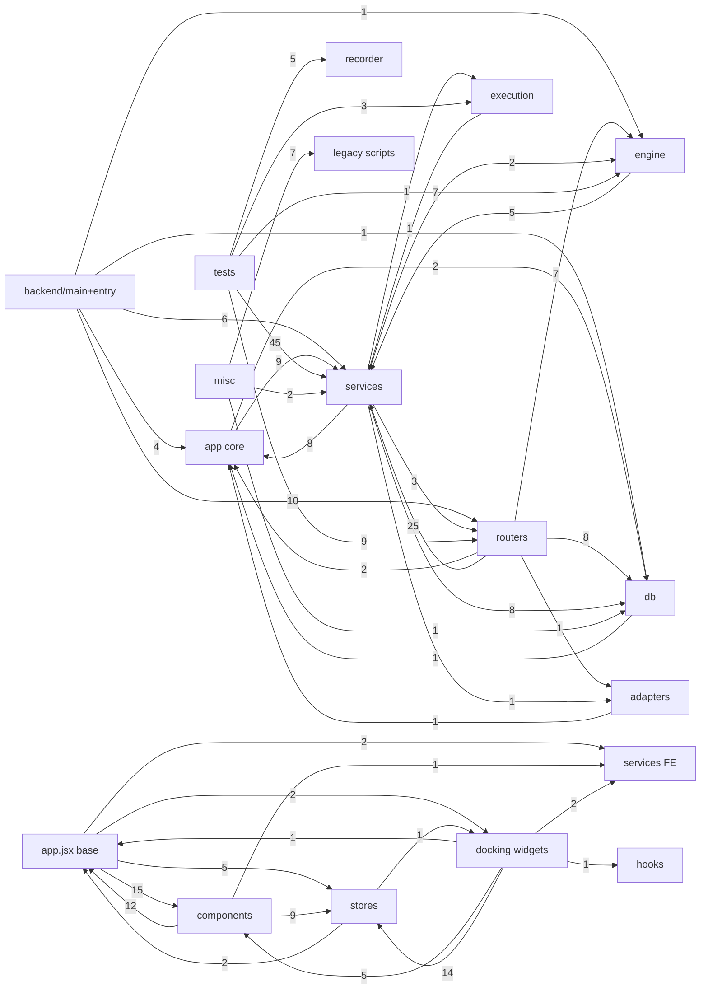

# 🕸️ CODEGRAPH SignalScript — карта кода и модульный граф

> **Назначение:** навигация по кодовой базе для агентов и разработчиков. Каждая нода = файл/модуль; связи = реальные импорты (извлечены AST-парсером Python и regex-парсером JS 2026-10-22).
> **Сырые данные:** `artifacts/codegraph_raw.json` (полный список зависимостей каждого файла).
> **Как пользоваться:** перед работой с модулем — найди ноду по слою, посмотри входящие/исходящие связи, контракты см. ROADMAP.md §0.

## 📊 Сводка

- Нод (файлов): **212** (py: 135, js/jsx: 77)
- Строк кода: py **27,929**, js/jsx **28,974**
- Внутренних связей (import): **370**

### 🔥 Топ-хабы по входящим связям (fan-in)

| Файл | Входящих связей | Строк |
|---|---|---|
| `backend\app\services\paper_trading.py` | 18 | 1090 |
| `backend\app\config.py` | 12 | 59 |
| `backend\app\db\database.py` | 11 | 70 |
| `backend\app\services\orderflow_backtester.py` | 11 | 2144 |
| `backend\app\db\models.py` | 10 | 196 |
| `backend\app\services\binance_service.py` | 8 | 167 |
| `backend\app\services\deep_intent_logger.py` | 8 | 179 |
| `backend\app\services\indicators\base.py` | 8 | 69 |
| `backend\app\routers\backtest.py` | 7 | 946 |
| `backend\app\engine\trade_contract.py` | 7 | 322 |
| `backend\app\services\live_paper_runner.py` | 7 | 1212 |
| `backend\app\services\market_data_provider.py` | 7 | 117 |
| `frontend\src\stores\colorLinksStore.js` | 7 | 139 |
| `backend\app\engine\regime_classifier.py` | 6 | 225 |
| `backend\app\services\historical_data_loader.py` | 6 | 485 |
| `frontend\src\features\pilot\model.js` | 6 | 100 |
| `backend\app\services\overnight_pilot.py` | 5 | 926 |
| `backend\app\services\openrouter_client.py` | 5 | 717 |
| `frontend\src\stores\backtestStore.js` | 5 | 302 |
| `frontend\src\stores\layoutStore.js` | 5 | 240 |

## 🗺️ Граф слоёв (Mermaid)

## 🏠 Backend Core (точка входа)

*backend/app — main.py, config, utils, logging* — 7 файлов

| Нода | Строк | Зависит от (внутр.) | Fan-in |
|---|---|---|---|
| `backend\app\api\routes.py` | 334 | `database.py`, `models.py`, `binance_service.py`, `bot.py`, `drawing_persistence.py`, `registry.py` +3 | 1 |
| `backend\app\logging_setup.py` | 96 | — | 1 |
| `backend\app\api\data_routes.py` | 86 | `binance_service.py`, `orderflow_backtester.py`, `recorder.py` | 1 |
| `backend\app\config.py` | 59 | — | 12 |
| `backend\app\utils.py` | 36 | — | 2 |
| `backend\app\__init__.py` | 1 | — | 0 |
| `backend\app\api\__init__.py` | 1 | — | 0 |

**Исходящие связи слоя:** services (9), db (2)

## 🔌 Backend Routers (HTTP API)

*backend/app/routers — FastAPI-эндпоинты* — 12 файлов

| Нода | Строк | Зависит от (внутр.) | Fan-in |
|---|---|---|---|
| `backend\app\routers\ai_copilot.py` | 1,508 | `config.py`, `database.py`, `models.py`, `regime_classifier.py`, `trade_contract.py`, `backtest.py` +3 | 3 |
| `backend\app\routers\backtest.py` | 946 | `binance.py`, `indicators.py`, `binance_service.py`, `historical_data_loader.py`, `orderflow_backtester.py` | 7 |
| `backend\app\routers\journal.py` | 686 | `config.py`, `database.py`, `models.py`, `ai_service.py`, `binance_service.py`, `__init__.py` +1 | 1 |
| `backend\app\routers\workspaces.py` | 268 | `database.py`, `models.py` | 1 |
| `backend\app\routers\paper_trading_router.py` | 207 | `trade_contract.py`, `live_paper_runner.py`, `openrouter_client.py`, `paper_trading.py` | 2 |
| `backend\app\routers\overnight_pilot.py` | 187 | `deep_intent_logger.py`, `overnight_pilot.py` | 2 |
| `backend\app\routers\quant_router.py` | 172 | `backtest.py`, `design_contracts.py`, `market_data_factory.py`, `market_data_provider.py`, `quant_engine.py`, `think_optimizer.py` | 2 |
| `backend\app\routers\adaptive_router.py` | 120 | `regime_classifier.py`, `walk_forward_engine.py`, `historical_data_loader.py` | 2 |
| `backend\app\routers\monitoring.py` | 113 | `background_worker.py`, `paper_trading.py` | 2 |
| `backend\app\routers\drawings.py` | 91 | `database.py`, `models.py`, `drawing_persistence.py` | 0 |
| `backend\app\routers\ai_settings.py` | 57 | `openrouter_client.py`, `openrouter_service.py` | 1 |
| `backend\app\routers\__init__.py` | 2 | — | 1 |

**Исходящие связи слоя:** services (25), db (8), engine (7), app core (2), adapters (1)

## ⚙️ Backend Engine (расчётное ядро)

*backend/app/engine — оптимизаторы, walk-forward, regime* — 7 файлов

| Нода | Строк | Зависит от (внутр.) | Fan-in |
|---|---|---|---|
| `backend\app\engine\background_worker.py` | 675 | `regime_classifier.py`, `trade_contract.py`, `walk_forward_engine.py`, `historical_data_loader.py`, `orderflow_backtester.py`, `paper_trading.py` | 3 |
| `backend\app\engine\walk_forward_engine.py` | 392 | `regime_classifier.py`, `historical_data_loader.py`, `orderflow_backtester.py` | 4 |
| `backend\app\engine\optimizer.py` | 380 | `indicators.py` | 1 |
| `backend\app\engine\trade_contract.py` | 322 | — | 7 |
| `backend\app\engine\indicators.py` | 235 | — | 3 |
| `backend\app\engine\regime_classifier.py` | 225 | — | 6 |
| `backend\app\engine\__init__.py` | 42 | `indicators.py`, `trade_contract.py` | 0 |

**Исходящие связи слоя:** services (5)

## 💱 Execution (симуляция исполнения)

*backend/app/services/execution + execution_simulator* — 5 файлов

| Нода | Строк | Зависит от (внутр.) | Fan-in |
|---|---|---|---|
| `backend\app\services\execution_simulator.py` | 384 | — | 2 |
| `backend\app\services\execution\paper.py` | 75 | `base.py`, `paper_trading.py` | 1 |
| `backend\app\services\execution\base.py` | 37 | — | 3 |
| `backend\app\services\execution\exchange.py` | 17 | `base.py` | 1 |
| `backend\app\services\execution\__init__.py` | 8 | `base.py`, `exchange.py`, `paper.py` | 2 |

**Исходящие связи слоя:** services (1)

## 🧠 Backend Services (бизнес-логика)

*backend/app/services — сканер, бэктестер, paper, AI, recorder* — 36 файлов

| Нода | Строк | Зависит от (внутр.) | Fan-in |
|---|---|---|---|
| `backend\app\services\orderflow_backtester.py` | 2,144 | — | 11 |
| `backend\app\services\live_paper_runner.py` | 1,212 | `trade_contract.py`, `backtest.py`, `deep_intent_logger.py`, `market_data_factory.py`, `openrouter_client.py`, `orderflow_backtester.py` +2 | 7 |
| `backend\app\services\paper_trading.py` | 1,090 | `trade_contract.py`, `early_exit_engine.py`, `execution_simulator.py` | 18 |
| `backend\app\services\overnight_pilot.py` | 926 | `database.py`, `models.py`, `ai_copilot.py`, `backtest.py`, `deep_intent_logger.py`, `live_paper_runner.py` +1 | 5 |
| `backend\app\services\openrouter_client.py` | 717 | `config.py` | 5 |
| `backend\app\services\deep_history.py` | 527 | — | 1 |
| `backend\app\services\historical_data_loader.py` | 485 | — | 6 |
| `backend\app\services\recorder.py` | 473 | `config.py` | 3 |
| `backend\app\services\free_binance_collector.py` | 417 | `market_data_provider.py` | 1 |
| `backend\app\services\scanner.py` | 315 | `database.py`, `models.py`, `binance_service.py`, `bot.py`, `coingecko.py`, `__init__.py` | 4 |
| `backend\app\services\quant_engine.py` | 296 | `market_data_factory.py`, `market_data_provider.py` | 3 |
| `backend\app\services\early_exit_engine.py` | 238 | — | 1 |
| `backend\app\services\ai_service.py` | 187 | `config.py` | 2 |
| `backend\app\services\bot.py` | 187 | `config.py`, `database.py`, `models.py`, `utils.py` | 3 |
| `backend\app\services\deep_intent_logger.py` | 179 | `config.py` | 8 |
| `backend\app\services\binance_service.py` | 167 | `__init__.py`, `config.py`, `database.py`, `models.py` | 8 |
| `backend\app\services\cluster_engine.py` | 135 | — | 1 |
| `backend\app\services\openrouter_service.py` | 129 | `config.py` | 2 |
| `backend\app\services\market_data_provider.py` | 117 | — | 7 |
| `backend\app\services\indicators\plugins\vwap.py` | 106 | `base.py` | 0 |
| `backend\app\services\indicators\plugins\rsi.py` | 95 | `base.py` | 0 |
| `backend\app\services\indicators\registry.py` | 82 | `base.py` | 2 |
| `backend\app\services\coingecko.py` | 74 | — | 1 |
| `backend\app\services\indicators\plugins\atr.py` | 74 | `base.py` | 0 |
| `backend\app\services\indicators\plugins\ema.py` | 74 | `base.py` | 0 |
| `backend\app\services\indicators\plugins\volume_spike.py` | 71 | `base.py` | 0 |
| `backend\app\services\design_contracts.py` | 70 | `market_data_provider.py` | 2 |
| `backend\app\services\market_data_factory.py` | 69 | `free_binance_collector.py`, `market_data_provider.py` | 3 |
| `backend\app\services\indicators\base.py` | 69 | — | 8 |
| `backend\app\services\indicators\plugins\cvd.py` | 69 | `base.py` | 0 |
| `backend\app\services\indicators\__init__.py` | 64 | `base.py`, `normalization.py`, `registry.py` | 3 |
| `backend\app\services\runtime_binding.py` | 62 | — | 2 |
| `backend\app\services\indicators\normalization.py` | 62 | — | 1 |
| `backend\app\services\think_optimizer.py` | 28 | — | 2 |
| `backend\app\services\drawing_persistence.py` | 22 | — | 3 |
| `backend\app\services\__init__.py` | 1 | — | 0 |

**Исходящие связи слоя:** db (8), app core (8), routers (3), engine (2), execution (1), adapters (1)

## 🗄️ Database (модели и доступ)

*backend/app/db — SQLAlchemy, SQLite WAL* — 3 файлов

| Нода | Строк | Зависит от (внутр.) | Fan-in |
|---|---|---|---|
| `backend\app\db\models.py` | 196 | — | 10 |
| `backend\app\db\database.py` | 70 | `config.py`, `models.py` | 11 |
| `backend\app\db\__init__.py` | 1 | — | 0 |

**Исходящие связи слоя:** app core (1)

## 🔁 Exchange Adapters

*backend/app/adapters — BaseExchangeAdapter, Bybit* — 4 файлов

| Нода | Строк | Зависит от (внутр.) | Fan-in |
|---|---|---|---|
| `backend\app\adapters\exchange\binance.py` | 252 | `base.py`, `config.py` | 2 |
| `backend\app\adapters\exchange\bybit.py` | 164 | `base.py` | 1 |
| `backend\app\adapters\exchange\base.py` | 53 | — | 3 |
| `backend\app\adapters\exchange\__init__.py` | 11 | `base.py`, `binance.py`, `bybit.py` | 1 |

**Исходящие связи слоя:** app core (1)

## 📦 Recorder (standalone data lake)

*recorder/ — отдельный процесс сбора рынка* — 7 файлов

| Нода | Строк | Зависит от (внутр.) | Fan-in |
|---|---|---|---|
| `recorder\service.py` | 155 | `events.py`, `gaps.py`, `storage.py` | 2 |
| `recorder\storage.py` | 92 | — | 2 |
| `recorder\events.py` | 67 | — | 2 |
| `recorder\config.py` | 38 | — | 2 |
| `recorder\__main__.py` | 36 | `config.py`, `service.py` | 0 |
| `recorder\gaps.py` | 28 | — | 2 |
| `recorder\__init__.py` | 2 | — | 0 |

## 🧪 Tests (защитная сеть)

*backend/tests — 212 тестов* — 36 файлов

| Нода | Строк | Зависит от (внутр.) | Fan-in |
|---|---|---|---|
| `backend\tests\test_overnight_pilot.py` | 659 | `overnight_pilot.py`, `overnight_pilot.py` | 0 |
| `backend\tests\test_backtest_golden_scenarios.py` | 551 | `orderflow_backtester.py` | 0 |
| `backend\tests\test_deep_intent_logging.py` | 426 | `deep_intent_logger.py`, `__init__.py`, `live_paper_runner.py`, `overnight_pilot.py`, `paper_trading.py` | 0 |
| `backend\tests\test_paper_trading.py` | 420 | `paper_trading.py` | 0 |
| `backend\tests\test_openrouter_chain.py` | 394 | `openrouter_client.py` | 0 |
| `backend\tests\test_execution_risk_hardening.py` | 296 | `execution_simulator.py`, `live_paper_runner.py`, `paper_trading.py` | 0 |
| `backend\tests\test_paper_kill_switch_and_forecast.py` | 271 | `ai_copilot.py`, `orderflow_backtester.py`, `paper_trading.py` | 0 |
| `backend\tests\test_trade_contract.py` | 266 | `trade_contract.py`, `paper_trading.py` | 0 |
| `backend\tests\test_live_paper_and_openrouter.py` | 229 | `deep_intent_logger.py`, `live_paper_runner.py`, `openrouter_client.py`, `paper_trading.py` | 0 |
| `backend\tests\test_historical_loader.py` | 211 | `optimizer.py`, `historical_data_loader.py` | 0 |
| `backend\tests\test_regime_classifier.py` | 197 | `regime_classifier.py`, `walk_forward_engine.py`, `paper_trading.py` | 0 |
| `backend\tests\test_ui_validation_contract.py` | 177 | `backtest.py`, `drawing_persistence.py`, `historical_data_loader.py` | 0 |
| `backend\tests\test_standalone_recorder_s1.py` | 159 | `config.py`, `events.py`, `gaps.py`, `service.py`, `storage.py` | 0 |
| `backend\tests\test_walk_forward_optimizer.py` | 145 | `regime_classifier.py`, `walk_forward_engine.py`, `adaptive_router.py`, `paper_trading.py` | 0 |
| `backend\tests\test_quant_engine_and_router.py` | 141 | `market_data_provider.py`, `quant_engine.py` | 0 |
| `backend\tests\test_genetic_optimizer_oos.py` | 136 | `orderflow_backtester.py` | 0 |
| `backend\tests\test_golden_backtest.py` | 134 | `orderflow_backtester.py` | 0 |
| `backend\tests\test_indicators_and_filters.py` | 99 | `__init__.py`, `scanner.py` | 0 |
| `backend\tests\test_paper_feed_health.py` | 81 | `deep_intent_logger.py`, `live_paper_runner.py`, `paper_trading.py` | 0 |
| `backend\tests\test_paper_telemetry_api.py` | 77 | `__init__.py`, `deep_intent_logger.py`, `overnight_pilot.py` | 0 |
| `backend\tests\test_monitoring.py` | 68 | `background_worker.py`, `monitoring.py` | 0 |
| `backend\tests\test_deep_history.py` | 67 | `deep_history.py` | 0 |
| `backend\tests\test_backtest_report_contract.py` | 63 | `backtest.py` | 0 |
| `backend\tests\test_paper_feed_recovery.py` | 57 | `deep_intent_logger.py`, `live_paper_runner.py`, `paper_trading.py` | 0 |
| `backend\tests\test_paper_trading_router.py` | 56 | `paper_trading_router.py`, `paper_trading.py` | 0 |
| `backend\tests\test_overnight_pilot_ui_contract.py` | 50 | — | 0 |
| `backend\tests\test_think_optimizer.py` | 46 | `quant_router.py`, `think_optimizer.py` | 0 |
| `backend\tests\test_runtime_binding.py` | 39 | `runtime_binding.py` | 0 |
| `backend\tests\test_ai_settings.py` | 37 | `openrouter_service.py` | 0 |
| `backend\tests\test_design_overlay_contract.py` | 37 | `design_contracts.py`, `market_data_provider.py` | 0 |
| `backend\tests\test_cluster_engine.py` | 36 | `cluster_engine.py` | 0 |
| `backend\tests\test_execution_providers.py` | 33 | `__init__.py`, `paper_trading.py` | 0 |
| `backend\tests\test_market_data_truth_contract.py` | 26 | — | 0 |
| `backend\tests\test_dockview_layout_sanitizer_contract.py` | 25 | — | 0 |
| `backend\tests\conftest.py` | 17 | — | 0 |
| `backend\tests\__init__.py` | 1 | — | 0 |

**Исходящие связи слоя:** services (45), routers (9), engine (7), recorder (5), execution (3)

## 🖥️ Frontend Base (каркас)

*frontend/src — App, main, index.css, theme* — 12 файлов

| Нода | Строк | Зависит от (внутр.) | Fan-in |
|---|---|---|---|
| `frontend\src\App.jsx` | 1,523 | `AICopilotSidebar.jsx`, `BacktestPanel.jsx`, `Chart.jsx`, `DecisionJournalModal.jsx`, `OrderBookDOM.jsx`, `ScalperTradeDesk.jsx` +15 | 1 |
| `frontend\src\DesignShowcase.jsx` | 431 | `ChartCanvasOverlay.jsx`, `LayerToolbar.jsx`, `LiqAnalyticsPanel.jsx`, `QuantDecisionConsilium.jsx`, `themes.js` | 1 |
| `frontend\src\config\indicatorsRegistry.js` | 328 | — | 4 |
| `frontend\src\utils\chartAnnotations.js` | 247 | — | 1 |
| `frontend\src\theme\themes.js` | 244 | — | 1 |
| `frontend\src\config\coinLibrary.js` | 231 | — | 2 |
| `frontend\src\config\drawingTemplates.js` | 195 | — | 1 |
| `frontend\src\utils\orderbookLogic.js` | 181 | — | 2 |
| `frontend\src\utils\sound.js` | 128 | — | 4 |
| `frontend\src\utils\researchVerdict.test.js` | 27 | `researchVerdict.js` | 0 |
| `frontend\src\utils\researchVerdict.js` | 23 | — | 3 |
| `frontend\src\main.jsx` | 17 | `App.jsx`, `DesignShowcase.jsx`, `index.css` | 0 |

**Исходящие связи слоя:** components (15), stores (5), docking widgets (2), services FE (2)

## 🧩 Frontend Components (основные)

*frontend/src/components — Chart, DOM, панели* — 29 файлов

| Нода | Строк | Зависит от (внутр.) | Fan-in |
|---|---|---|---|
| `frontend\src\components\Chart.jsx` | 4,801 | `AssistantHUD.jsx`, `ActiveIndicatorStack.jsx`, `IndicatorSettingsDialog.jsx`, `IndicatorsModal.jsx`, `drawingTemplates.js`, `indicatorsRegistry.js` +8 | 2 |
| `frontend\src\components\BacktestPanel.jsx` | 2,807 | `BacktestTradeTimeline.jsx`, `LivePaperTradingView.jsx`, `backtestStore.js`, `researchVerdict.js` | 1 |
| `frontend\src\components\OrderBookDOM.jsx` | 1,340 | `OrderBookCanvasLadder.jsx`, `orderbookLogic.js`, `sound.js` | 2 |
| `frontend\src\components\AICopilotSidebar.jsx` | 1,121 | — | 1 |
| `frontend\src\components\SettingsModal.jsx` | 928 | `AIEngineSettings.jsx` | 0 |
| `frontend\src\components\ScalperTradeDesk.jsx` | 731 | `sound.js` | 1 |
| `frontend\src\components\DecisionJournalModal.jsx` | 692 | — | 1 |
| `frontend\src\components\OrderBook.jsx` | 681 | `orderbookLogic.js`, `sound.js` | 0 |
| `frontend\src\components\LivePaperTradingView.jsx` | 623 | `backtestStore.js` | 1 |
| `frontend\src\components\IndicatorsModal.jsx` | 605 | — | 0 |
| `frontend\src\components\OvernightPilotPanel.jsx` | 488 | — | 0 |
| `frontend\src\components\AssistantHUD.jsx` | 368 | — | 1 |
| `frontend\src\components\OrderBookCanvasLadder.jsx` | 360 | `tradeOverlayStore.js` | 1 |
| `frontend\src\components\BacktestModal.jsx` | 353 | — | 0 |
| `frontend\src\components\design-previews\LiqAnalyticsPanel.jsx` | 352 | — | 3 |
| `frontend\src\components\Tape.jsx` | 261 | — | 1 |
| `frontend\src\components\indicators\IndicatorsModal.jsx` | 253 | `indicatorsRegistry.js` | 1 |
| `frontend\src\components\design-previews\LayerToolbar.jsx` | 237 | — | 2 |
| `frontend\src\components\indicators\IndicatorSettingsDialog.jsx` | 231 | `indicatorsRegistry.js` | 1 |
| `frontend\src\components\design-previews\QuantDecisionConsilium.jsx` | 222 | — | 3 |
| `frontend\src\components\design-previews\ChartCanvasOverlay.jsx` | 215 | — | 2 |
| `frontend\src\components\RecorderModal.jsx` | 212 | — | 0 |
| `frontend\src\components\indicators\ActiveIndicatorStack.jsx` | 140 | `indicatorsRegistry.js` | 1 |
| `frontend\src\components\SignalsFeed.jsx` | 135 | — | 1 |
| `frontend\src\components\PaperTradePanel.jsx` | 122 | — | 0 |
| `frontend\src\components\BacktestTradeTimeline.jsx` | 111 | — | 1 |
| `frontend\src\components\FootprintClusters.jsx` | 92 | — | 0 |
| `frontend\src\components\AIEngineSettings.jsx` | 55 | — | 1 |
| `frontend\src\components\design-previews\index.js` | 37 | — | 0 |

**Исходящие связи слоя:** app.jsx base (12), stores (9), services FE (1)

## 🗂️ Frontend Docking (виджеты-мозаика)

*frontend/src/components/docking — dockview, скринер, лента* — 14 файлов

| Нода | Строк | Зависит от (внутр.) | Fan-in |
|---|---|---|---|
| `frontend\src\components\docking\TerminalDockview.jsx` | 811 | `Chart.jsx`, `OrderBookDOM.jsx`, `ChartCanvasOverlay.jsx`, `LiqAnalyticsPanel.jsx`, `QuantDecisionConsilium.jsx`, `ChannelSelector.jsx` +14 | 1 |
| `frontend\src\components\docking\TradeHistoryWidget.jsx` | 587 | — | 1 |
| `frontend\src\components\docking\TradesWidget.jsx` | 534 | `ChannelSelector.jsx`, `TradesSettings.jsx`, `useTradeAudioAlerts.js`, `colorLinksStore.js`, `tradesStore.js` | 1 |
| `frontend\src\components\docking\AlertsModal.jsx` | 491 | `marketTruth.js`, `alertsStore.js` | 1 |
| `frontend\src\components\docking\ScreenerWidget.jsx` | 440 | `ChannelSelector.jsx`, `coinLibrary.js`, `colorLinksStore.js`, `marketDataStore.js` | 2 |
| `frontend\src\components\docking\TradesSettings.jsx` | 303 | — | 1 |
| `frontend\src\components\docking\WidgetHubModal.jsx` | 244 | `layoutStore.js` | 1 |
| `frontend\src\components\docking\PresetBar.jsx` | 218 | `layoutStore.js` | 1 |
| `frontend\src\components\docking\ChannelSelector.jsx` | 122 | `colorLinksStore.js` | 4 |
| `frontend\src\components\docking\Placeholders.jsx` | 87 | `ChannelSelector.jsx`, `colorLinksStore.js` | 1 |
| `frontend\src\components\docking\layoutRecovery.js` | 64 | — | 1 |
| `frontend\src\components\docking\layoutRecovery.test.js` | 55 | — | 0 |
| `frontend\src\components\docking\layoutSanitizer.js` | 29 | — | 1 |
| `frontend\src\components\docking\WatchlistWidget.jsx` | 10 | `ScreenerWidget.jsx` | 1 |

**Исходящие связи слоя:** stores (14), components (5), services FE (2), hooks (1), app.jsx base (1)

## 📦 Frontend Stores (Zustand)

*frontend/src/stores — persist-хранилища* — 9 файлов

| Нода | Строк | Зависит от (внутр.) | Fan-in |
|---|---|---|---|
| `frontend\src\stores\marketDataStore.js` | 325 | `coinLibrary.js`, `researchVerdict.js` | 4 |
| `frontend\src\stores\tradesStore.js` | 318 | `marketDataStore.js` | 2 |
| `frontend\src\stores\backtestStore.js` | 302 | `tradeOverlayStore.js` | 5 |
| `frontend\src\stores\layoutStore.js` | 240 | `layoutRecovery.js` | 5 |
| `frontend\src\stores\colorLinksStore.js` | 139 | — | 7 |
| `frontend\src\stores\quantStore.js` | 126 | — | 2 |
| `frontend\src\stores\alertsStore.js` | 125 | — | 2 |
| `frontend\src\stores\tradeOverlayStore.js` | 63 | — | 4 |
| `frontend\src\stores\marketDataStore.test.js` | 45 | `marketDataStore.js` | 0 |

**Исходящие связи слоя:** app.jsx base (2), docking widgets (1)

## 🌐 Frontend Services (данные)

*frontend/src/services — fetchers, marketTruth* — 4 файлов

| Нода | Строк | Зависит от (внутр.) | Fan-in |
|---|---|---|---|
| `frontend\src\services\marketDataFetcher.js` | 348 | — | 1 |
| `frontend\src\services\marketTruth.test.js` | 33 | `backtestStrategyLevels.js`, `marketTruth.js` | 0 |
| `frontend\src\services\backtestStrategyLevels.js` | 23 | — | 2 |
| `frontend\src\services\marketTruth.js` | 10 | — | 4 |

## 🪝 Frontend Hooks

*frontend/src/hooks* — 1 файлов

| Нода | Строк | Зависит от (внутр.) | Fan-in |
|---|---|---|---|
| `frontend\src\hooks\useTradeAudioAlerts.js` | 202 | — | 1 |

## ✨ Frontend Features

*frontend/src/features* — 8 файлов

| Нода | Строк | Зависит от (внутр.) | Fan-in |
|---|---|---|---|
| `frontend\src\features\pilot\store.js` | 113 | `api.js`, `model.js` | 2 |
| `frontend\src\features\pilot\pilot.test.js` | 103 | `model.js`, `store.js` | 0 |
| `frontend\src\features\pilot\model.js` | 100 | — | 6 |
| `frontend\src\features\pilot\PilotConfig.jsx` | 59 | `model.js` | 2 |
| `frontend\src\features\pilot\PilotResults.jsx` | 52 | `PilotConfig.jsx`, `model.js` | 2 |
| `frontend\src\features\pilot\PilotWorkspace.jsx` | 48 | `PilotConfig.jsx`, `PilotDashboard.jsx`, `PilotResults.jsx`, `model.js`, `store.js` | 0 |
| `frontend\src\features\pilot\PilotDashboard.jsx` | 31 | `PilotResults.jsx`, `model.js` | 1 |
| `frontend\src\features\pilot\api.js` | 26 | — | 1 |

## 📜 Legacy / root scripts

*корневые CLI-скрипты, engine/, strategies/* — 10 файлов

| Нода | Строк | Зависит от (внутр.) | Fan-in |
|---|---|---|---|
| `engine\backtester.py` | 233 | — | 2 |
| `engine\data_loader.py` | 168 | — | 2 |
| `engine\volume_profile.py` | 113 | — | 2 |
| `engine\scanner.py` | 97 | `data_loader.py`, `indicators.py`, `volume_profile.py`, `cluster_breakout_strategy.py`, `mtf_pullback.py` | 1 |
| `strategies\mtf_pullback.py` | 94 | `strategy_base.py` | 2 |
| `engine\crypto_lake_loader.py` | 88 | — | 0 |
| `engine\indicators.py` | 80 | — | 2 |
| `strategies\cluster_breakout_strategy.py` | 73 | `strategy_base.py`, `volume_profile.py` | 2 |
| `engine\strategy_base.py` | 71 | — | 2 |
| `engine\optimizer.py` | 44 | `backtester.py` | 1 |

## ❓ Прочее

** — 6 файлов

| Нода | Строк | Зависит от (внутр.) | Fan-in |
|---|---|---|---|
| `analyzer.py` | 338 | — | 0 |
| `test_e2e.py` | 217 | — | 0 |
| `verify_features.py` | 167 | — | 0 |
| `backtest_cli.py` | 152 | `backtester.py`, `data_loader.py`, `indicators.py`, `optimizer.py`, `cluster_breakout_strategy.py`, `mtf_pullback.py` | 0 |
| `scanner_cli.py` | 88 | `scanner.py` | 0 |
| `test_scanner_cli.py` | 66 | `database.py`, `binance_service.py`, `scanner.py` | 0 |

**Исходящие связи слоя:** legacy scripts (7), services (2), db (1)

## 📦 Внешние зависимости (npm) по слоям

| Слой | Ключевые пакеты |
|---|---|
| FBS | lucide-react, node:assert, node:test, react, react-dom |
| CMP | klinecharts, lucide-react, react |
| DCK | dockview-react, lucide-react, node:assert, node:test, react |
| STO | node:assert, node:test, zustand |
| SRF | node:assert, node:test |
| HKF | react |
| FTR | node:assert, node:test, react, react-dom, zustand |

---

## 🧭 Правила работы с графом (для агентов)

1. **Меняя ноду — проверь fan-in:** файлы с высоким fan-in (`orderflow_backtester.py`, `trade_contract.py`, `Chart.jsx`, stores) — контрактные; любое изменение только с тестами.
2. **Слоёвое правило:** API → SRV/ENG → DB; компоненты (CMP/DCK) → STO/SRF. Запрещены обратные связи (DB → SRV, STO → CMP).
3. **REC и TST не зависят от runtime-бэкенда** — recorder отдельный процесс; тесты не импортируют frontend.
4. **EXE (execution_simulator) — заморожен** без согласования (см. HANDOFF.md 🔒).
5. Обновлять этот файл после крупных рефакторингов (перегенерация: `artifacts/codegraph_raw.json` + build-скрипт).
