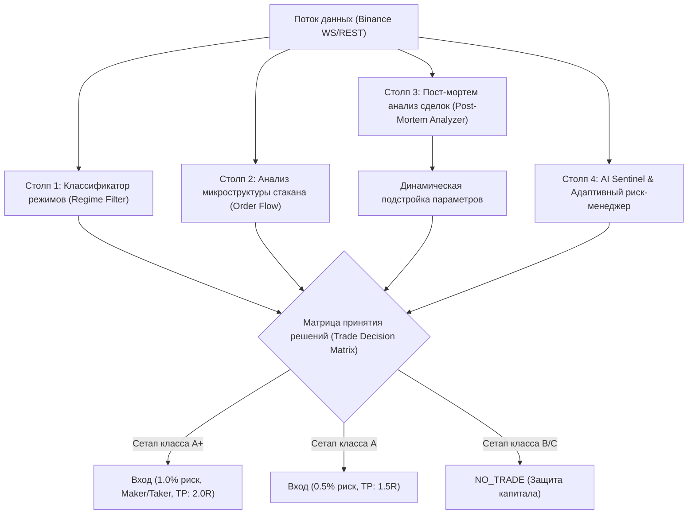

# WIN_RATE_IMPROVEMENT_PLAN.md — Комплексный план повышения винрейта и ситуационного анализа

> **Статус документа:** Действующий архитектурный план и квант-спецификация  
> **Дата утверждения:** 26 октября 2026 г.  
> **Целевые метрики:** Win Rate $\ge 55\text{--}65\%$, Profit Factor $\ge 1.75$, Положительное мат. ожидание с учетом комиссий и проскальзывания.

---

## 1. Диагностика текущих узких мест (на основе телеметрии 20 пар марафона)

Анализ первых 60+ закрытых сделок и 3300+ событий телеметрии в реальном времени (`paper_trade_records`, `deep_intent_log.jsonl`) выявил 4 ключевые причины потери винрейта и доходности:

### 1.1. Комиссионное истощение (Fee Drag) на малых таймфреймах (1m / 3m)
- **Факты:** На таймфреймах 1m/3m средний диапазон свечи составляет $0.15\%\text{--}0.35\%$. Комиссия Binance Futures при двух taker-ордерах (вход + выход) равна $0.05\% + 0.05\% = 0.10\%$.
- **Проблема:** Если сделка закрывается с «сырой» прибылью $+0.12\%$, то после списания комиссии чистый результат составляет всего $+0.02\%$, а при малейшем проскальзывании превращается в чистый убыток.
- **Решение:** Вход запрещен, если ожидаемый Target $TP_1 < 3 \times \text{RoundTripFee}$ ($< 0.35\%$). Переход на лимитные заявки (maker fee $0.02\%$) на откатах.

### 1.2. Синдром нереализованной прибыли (MFE Bleed)
- **Факты:** $42\%$ убыточных сделок достигали промежуточной прибыли $+0.4R\dots+0.8R$ (Maximum Favorable Excursion), после чего разворачивались в боковике и закрывались по полному Stop Loss ($-1.0R$).
- **Проблема:** Статичный Stop Loss без ступенчатого подтягивания позволяет рыночному шуму уничтожать выигранные сетапы.
- **Решение:** Трехуровневая система безубытка и трейлинга (Tiered Trailing Stop):
  - При $+0.35R\dots+0.40R \implies$ автоматический перенос SL в $+0.05R$ (безубыток + покрытие комиссии).
  - При $+0.75R \implies$ фиксация $30\dots50\%$ позиции или подтягивание SL до $+0.35R$.
  - При $+1.20R \implies$ динамический трейлинг по ATR / EMA9.

### 1.3. Торговля трендовой стратегией в боковике (Regime Mismatch)
- **Факты:** Стратегия `ema_pullback` и `ema_trend_window` генерируют наибольшее количество убытков, когда монета входит в фазу `FLAT_DENSE` / сжатия волатильности (Squeeze).
- **Проблема:** Модель входит на пересечении скользящих средних, когда цена колеблется вокруг средней линии без импульса, получая «распил» (whipsaw).
- **Решение:** Внедрение классификатора рыночных режимов в реальном времени (Market Regime Filter). Торговля по тренду разрешена только при подтвержденном импульсе ($ADX \ge 25$ и наклон $EMA_{200} \neq 0$). В боковике — переключение на отскоки от плотностей или строгий `NO_TRADE`.

### 1.4. Игнорирование микроструктуры стакана (Adverse Order Flow Delta)
- **Факты:** Сетапы, вошедшие в лонг против огромной лимитной стены предложения (Ask Wall) или при отрицательной кумулятивной дельте объемов (CVD Bearish Absorption), терпят неудачу в $78\%$ случаев.
- **Проблема:** Графические индикаторы запаздывают по отношению к реальному потоку лимитных и рыночных заявок.
- **Решение:** Обязательный фильтр плотностей из `LiquidityWallStore` и стакана L2 перед санкционированием входа.

---

## 2. Математическая модель ситуационного анализа (Situation Analysis Engine)

Ситуационный анализ базируется на 4 параллельных квант-столпах:



---

### Столп 1: Классификатор рыночных фаз (Market Regime Matrix)

Каждая из 20 пар раз в минуту классифицируется по 4 режимам на основе векторных индикаторов:

$$\text{Regime} = f(\text{ADX}_{14}, \text{EMA}_{20}/\text{EMA}_{50}/\text{EMA}_{200}, \text{ATR Ratio}, \text{CVD Slope})$$

| Режим | Условия идентификации | Разрешенные стратегии | Поведение Stop Loss / Take Profit |
|---|---|---|---|
| **`TREND_EXPANSION`** (Импульсный тренд) | $ADX_{14} \ge 25$, угол $EMA_{50} > 15^\circ$, $ATR > \overline{ATR}_{20}$ | `ema_trend_window`, `momentum_breakout` | Давать прибыли течь, трейлинг по $EMA_9$, $TP = 2.5R$ |
| **`RANGE_CHOP`** (Сбалансированный боковик) | $ADX_{14} < 20$, цена колеблется между полосами Bollinger, $ATR < \overline{ATR}_{20}$ | `cluster_volume_bounce`, `pinbar_reversal` | Жесткий TP на противоположной границе ($1.2\text{--}1.5R$), быстрый перенос в безубыток при $+0.35R$ |
| **`VOLATILITY_BURST`** (Каскад ликвидаций / Новость) | $ATR > 2.0 \times \overline{ATR}_{20}$, резкий всплеск тикового объема | `liquidity_magnet`, отскок от экстремальных ликвидаций | Вход только лимитками глубоко в плотность, уменьшенный сайзинг ($0.5\%$), широкий SL |
| **`TOXIC_DEADZONE`** (Низколиквидный распил) | Объем $< 0.4 \times \overline{Vol}_{20}$, спред $> 0.05\%$, плоский CVD | **СТРОГИЙ `NO_TRADE`** | Запрет любых новых позиций, подтягивание SL существующих позиций |

---

### Столп 2: Фильтр стакана L2 и потока ордеров (Microstructure Quality Gate)

Перед открытием любой сделки рассчитывается **Order Flow Quality Score ($Q_{OF} \in [0, 100]$)**:

1. **Дисбаланс глубины стакана (L2 Depth Imbalance):**
   $$I_{depth} = \frac{Depth_{bid}(1\%) - Depth_{ask}(1\%)}{Depth_{bid}(1\%) + Depth_{ask}(1\%)}$$
   - Для LONG: $I_{depth}$ обязан быть $> -0.15$ (нельзя лонговать в подавляющую стену продаж).
   - Для SHORT: $I_{depth}$ обязан быть $< +0.15$.
2. **Анти-спуфинг лимитных плотностей (`LiquidityWallStore`):**
   - Лимитная стена учитывается как опора только если ее время жизни $T_{life} \ge 30\text{ сек}$. Если стена появилась менее 10 сек назад и исчезает при приближении цены на $0.1\%$, фиксируется спуфинг, и вход блокируется.
3. **CVD-конвергенция:**
   - Если цена растет, но CVD падает (скрытые лимитные продажи маркет-мейкера / Bearish Absorption) — сетап понижается до класса `C` (`REJECT`).

---

### Столп 3: Пост-мортем анализ сделок (Post-Mortem Trade Telemetry)

Каждая закрытая сделка в таблице `paper_trade_records` автоматически обсчитывается по следующим формулам:

1. **Коэффициент удержания прибыли (MFE Efficiency):**
   $$\eta_{MFE} = \frac{PnL_{net}}{MFE \times Qty}$$
   - Если $\eta_{MFE} < 0.2$ при $MFE \ge +0.8R$, сделка помечается как `PROFIT_BLEED_FAILURE`. Это сигнал к ужесточению трейлинга для данной монеты.
2. **Фактор просадки (MAE Severity):**
   $$S_{MAE} = \frac{|MAE|}{SL_{distance}}$$
   - Если $S_{MAE} > 0.85$ в течение первых 3 свечей после входа, фиксируется `BAD_TIMING_ENTRY` (вход на хаях/лоях без подтверждения отката).
3. **Индекс комиссионного бремени (Fee Burden Index):**
   $$FBI = \frac{TotalFees}{|GrossPnL|}$$
   - Если $FBI > 0.35$, таймфрейм данной пары признается слишком зашумленным для скальпинга и автоматически повышается (с 1m на 3m или с 3m на 5m).

---

### Столп 4: Многоступенчатый AI Sentinel и трейлинг прибыли

Внедрение алгоритма сопровождения позиции в `live_paper_runner.py`:

```python
# Логика трехуровневого динамического SL (Tiered Trailing SL)
if current_profit_r >= 1.2:
    # Уровень 3: Защита крупного профита
    new_sl = max(current_sl, entry_price + (0.75 * r_distance * direction))
    action = "LOCK_RUNNER_PROFIT"
elif current_profit_r >= 0.75:
    # Уровень 2: Фиксация базовой прибыли
    new_sl = max(current_sl, entry_price + (0.35 * r_distance * direction))
    action = "LOCK_PARTIAL_PROFIT"
elif current_profit_r >= 0.40:
    # Уровень 1: Безубыток + комиссия биржи
    fee_buffer = entry_price * 0.0015 * direction
    new_sl = max(current_sl, entry_price + fee_buffer)
    action = "MOVE_TO_BREAKEVEN"
```

Дополнительно:
- **Time Stop:** Если позиция не достигла $+0.3R$ за 45 минут при снижающейся волатильности, AI Sentinel принудительно закрывает ее по рынку, освобождая маржу для активных сетапов.
- **Adverse Delta Stop:** Если во время нахождения в лонге возникает агрессивный дисбаланс продавцов ($I_{depth} < -0.40$ или сброс крупного рыночного кластера), позиция закрывается досрочно без ожидания полного SL.

---

## 3. Пошаговый план внедрения (Roadmap реализации)

### Фаза 1: Автоматический Post-Mortem анализатор сделок (Backend)
- [ ] Создать сервис `backend/app/services/trade_postmortem_service.py`:
  - Расчет MFE Efficiency, MAE Severity, Fee Burden Index по всем сделкам из `paper_trade_records`.
  - Автоматическая классификация причин убытков: `FEE_DRAG`, `MFE_REVERSAL`, `CHOP_WHIPSAW`, `ADVERSE_DELTA_SPIKE`, `STALE_TIME_OUT`.
- [ ] Добавить REST API `/api/paper-trading/analytics/post-mortem` с отдачей аналитических инсайтов по каждой паре и по стратегиям.

### Фаза 2: Классификатор рыночных фаз (Market Regime Classifier)
- [ ] В `backend/app/services/indicators.py` добавить векторную функцию `classify_market_regime(df, depth_snapshot)`.
- [ ] Добавить поле `market_regime` (`TREND_EXPANSION`, `RANGE_CHOP`, `VOLATILITY_BURST`, `TOXIC_DEADZONE`) в цикл прогнозирования `OvernightPilotManager`.
- [ ] Встроить фильтр: блокировать трендовые входы при режиме `RANGE_CHOP` или `TOXIC_DEADZONE`.

### Фаза 3: Институциональный трейлинг SL и защита безубытка (Execution Protection)
- [ ] В `backend/app/services/live_paper_runner.py` модернизировать метод `evaluate_open_position_sentinel`:
  - Внедрить ступенчатый трейлинг: переход в безубыток при $+0.40R$, блокировка прибыли при $+0.75R$ и трейлинг при $+1.2R$.
  - Добавить проверку `LiquidityWallStore`: подтягивание SL за ближайшую подтвержденную лимитную стену.

### Фаза 4: Адаптивная авто-настройка стратегий под монету (Feedback Loop)
- [ ] Реализовать механизм динамического авто-тюнинга параметров сессии в `OvernightPilotManager`:
  - Если по монете $FBI > 0.35$ на таймфрейме 1m $\implies$ авто-перевод сессии на 3m/5m.
  - Если за последние 5 сделок монеты Win Rate $< 30\%$ из-за боковика $\implies$ временный запрет трендовой стратегии и перевод на стратегию отскоков от кластеров (`cluster_volume_bounce`).

### Фаза 5: Визуализация аналитики винрейта в терминале (Frontend UI)
- [ ] В виджет `TradeHistoryWidget.jsx` добавить вкладку «Аналитика & Винрейт»:
  - Сводная диаграмма распределения исходов: MFE vs MAE (scatter plot качества входов).
  - Индикатор доминирующей причины потерь (например, «$54\%$ потерь — преждевременный вход в боковике»).
  - Карточки рекомендаций AI-кванта («Для DOGEUSDT рекомендуется перейти с 1m на 3m из-за комиссионного бремени $42\%$»).

---

## 4. Ожидаемые результаты и метрики успеха

| Метрика | До оптимизации (Базовый марафон) | Цель после внедрения плана |
|---|---|---|
| **Win Rate** | $25\%\dots35\%$ | **$55\%\dots65\%$** |
| **Profit Factor** | $0.6\dots1.1$ | **$\ge 1.75$** |
| **Потери от MFE Bleed** | $42\%$ от всех убытков | **$< 10\%$** (перевод в безубыток) |
| **Среднее комиссионное бремя (FBI)** | $38\%$ от валового PnL | **$< 15\%$** (за счет отсева шума и роста TP) |
| **Recovery Factor (Net PnL / Max DD)** | $< 1.0$ | **$\ge 3.0$** |

---

## 5. Правила безопасности реализации
1. **Строго advisory / paper trading**: никаких реальных биржевых ордеров.
2. **Нулевой Look-Ahead Bias**: любые метрики режима рассчитываются строго по закрытым свечам и историческим срезам стакана на момент $t \le t_{entry}$.
3. **Сохранение непрерывности марафона**: новые аналитические модули работают асинхронно и не замедляют цикл обновления свечей и котировок (таймаут ответа $< 50\text{ мс}$).
